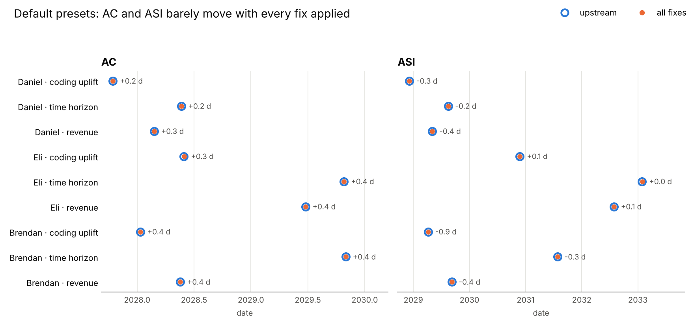
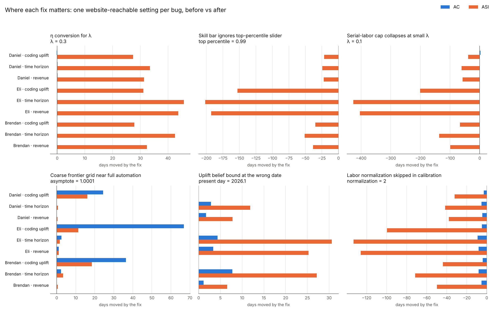

# Bugs found and fixed in this fork

This fork of the AI Futures Model core fixes mathematical, numerical and code
bugs. Model structure and parameter values are left alone. Each fix is its own
commit, and the website runs from this repository exactly as it does upstream
(`npm run dev`).

## Headline

**The default forecasts are not driven by any bug we found.** With every fix
applied, AC and ASI move by less than a day in all nine combinations of the three
08-16-26 presets (Daniel, Eli, Brendan) and the three AC anchors (coding uplift,
time horizon, revenue):



| Preset | AC anchor | AC upstream | AC fixed | Δ days | ASI upstream | ASI fixed | Δ days |
|---|---|---|---|---|---|---|---|
| Daniel | coding uplift | 2027-10-15 | 2027-10-15 | +0.2 | 2028-12-05 | 2028-12-05 | -0.3 |
| Daniel | time horizon | 2028-05-21 | 2028-05-22 | +0.2 | 2029-08-15 | 2029-08-15 | -0.2 |
| Daniel | revenue | 2028-02-24 | 2028-02-24 | +0.3 | 2029-05-04 | 2029-05-03 | -0.4 |
| Eli | coding uplift | 2028-05-30 | 2028-05-30 | +0.3 | 2030-11-24 | 2030-11-24 | +0.1 |
| Eli | time horizon | 2029-10-26 | 2029-10-26 | +0.4 | 2033-01-28 | 2033-01-28 | +0.0 |
| Eli | revenue | 2029-06-24 | 2029-06-25 | +0.4 | 2032-07-28 | 2032-07-28 | +0.1 |
| Brendan | coding uplift | 2028-01-10 | 2028-01-11 | +0.4 | 2029-04-07 | 2029-04-06 | -0.9 |
| Brendan | time horizon | 2029-10-31 | 2029-11-01 | +0.4 | 2031-07-27 | 2031-07-27 | -0.3 |
| Brendan | revenue | 2028-05-18 | 2028-05-18 | +0.4 | 2029-09-07 | 2029-09-07 | -0.4 |

The bugs do matter once a slider moves away from the preset value. Each one
below is shown at a setting the website allows:



## The bugs

Ranked by how far they move dates at website-reachable settings. "Defaults"
means the largest change over the nine preset × anchor cells.

| # | Commit | Bug | Defaults | Where it bites |
|---|---|---|---|---|
| 1 | Measure skill milestones from the top_percentile slider, not a constant | SAR/SIAR/TED-AI/ASI bars hard-coded to the 99.9th percentile | 0 d | top percentile 0.99: ASI −22 to −202 d; 0.99999: ASI +139 to +1136 d |
| 2 | Keep the coding-labor frontier accurate as automation approaches 100% | serial-labor cap collapses for λ < 0.27; frontier grid too coarse near i → 1 | ≤ 0.2 d | λ = 0.1: ASI −39 to −427 d; asymptote 1.0001: AC +24 to +67 d |
| 3 | Read AI taste SD off its schedule instead of inverting the saturated taste | SD series drops to 0 once taste saturates, so ASI never fires | 0 d | taste limit 0, slowdown 0.999: ASI missing in all 9 cells |
| 4 | Apply coding_labor_normalization consistently in calibration | normalization left out of two calibration steps | 0 d | normalization 2: ASI +32 to +133 d (should be 0) |
| 5 | Fix the λ adjustment of the automation efficiency slope η | η (in OOMs) converted for λ as η^(0.5/λ) instead of η·0.5/λ | 0 d (λ = 0.5) | λ = 0.3: ASI +27 to +46 d; λ = 0.75: ASI +5 to +6 d |
| 6 | Bind the uplift belief at its own date in the observable AC modes | uplift belief bound at present day via a doubling time the mode then discards | 0 d | present day 2026.1: ASI +6 to +31 d |
| 7 | Locate milestones on the solver's continuous solution, not the output grid | milestone dates and quantities read off a 0.1-year grid | AC +0.3 d, ASI −1.0 d | fast takeoff: ASI +8.6 d; multiplier at ASI 9.4e8 → 5.2e5 |
| 8 | Use the trapezoidal rule the comment promises for E[max(T, F)] | left Riemann sum labelled "trapezoidal" | ≤ 0.2 d | 0.16% error in aggregate taste |
| 9 | Do not extrapolate a failed ODE solve past its failure point | failed solve extrapolated to 2200 | 0 d | only if every solver fails (not reached from the website) |
| 10 | Return the ρ < 0 limit when one CES input is zero | CES of complements with a zero input returned w^(1/ρ)·X instead of 0 | 0 d | only at exactly zero input |
| 11 | Resolve the first cell of the coding-labor frontier | first task-grid cell blended log B = −∞ linearly and was one coarse step where E_aut(i) falls steeply | < 0.01 d | 0.1–0.5% in the test-suite trajectories |
| 12 | Clamp a copy of the ODE state, not the solver's own array | ODE bounds wrote into the solver's state vector | 0 d | only when a clamp fires (runaway or negative state) |
| 13 | Drop a zero-weight CES input in the Cobb-Douglas and Leontief branches | zero-weight input not dropped in two CES branches | 0 d | only at an exactly zero weight |
| 14 | Take the capability-limited task index from the automation schedule | AI-capable task share interpolated from a tabulated inverse instead of the closed-form schedule | ≤ 0.1 d | coding labor after AC: 1–5% in the test-suite trajectories |

Bugs 11–14 were found by a second, independent audit of the same code and
ported here. That audit also found bugs 1, 2, 3, 8, 9 and 10. Both audits
report sub-day changes at the presets.

Bug 5 is the starting point for this fork (the same error appears in the
parameter rationale, which states η_slope = (η_slope|λ=0.5)^(0.5/λ)). Commit
messages carry the full explanation of each bug; the worst are explained below.

### Skill milestones ignore the top-percentile slider (bug 1)

SAR is "as good as the best human researcher", SIAR is two top-to-median gaps
beyond that, and TED-AI and ASI are measured in the same gaps. The best
researcher's position is the `top_percentile` slider, and that slider does
reshape the taste distribution. The milestone thresholds, however, used the
constant `TOP_RESEARCHER_SD = norm.ppf(0.999) = 3.09`.

At 0.99999 the best human sits at 4.26 SD, yet SAR fired at 3.09 SD, below the
best human. Moving the slider shifts ASI by up to three years without the
milestone definitions moving with it.

### Serial-labor cap collapses at small λ (bug 2)

`max_serial_coding_labor_multiplier` (default 1e8) is meant to cap how much
serial coding labor AIs can add. The optimal-CES frontier enforces the cap in
parallel space. It converts the cap to cap^(1/λ), turns that into a tail cutoff
tail_eps = cap^(ρ/(1−ρ)), and integrates over tasks i ∈ [0, 1 − tail_eps].

For λ below 8/30, cap^(1/λ) exceeds the 1e30 bound and is clipped, and tail_eps
is clipped to 1e-20. But 1 − 1e-20 == 1.0 in floating point. The grid therefore
runs to i = 1, and the only thing stopping log(1 − i) from being −∞ is a `+ 1e-18`
fudge term. The effective cap becomes about (1e27)^λ: 2.5e5 at λ = 0.2 and 501
at λ = 0.1, instead of 1e8.

At λ = 0.1 this delays Eli's ASI by up to 14 months. Separately, the grid was
uniform in i, so the last cell spanned 1 − i from 2.4e-4 down to about 2e-11 with
log(1 − i) interpolated linearly across it. With the automation asymptote near 1
that gave errors of up to 1.7× in coding labor.

The fix tabulates in 1 − i (uniform down to 0.01, then geometric) and derives the
cap in log space. We re-derived the frontier's closed forms from first principles
and they are correct; only the discretisation was wrong.

### Labor normalization and the uplift date (bugs 4 and 6)

These are two calibration inconsistencies with the same shape: a quantity is
stated in one convention and consumed in another.

- **Labor normalization.** `coding_labor_normalization` multiplies serial coding
  labor in the ODE, the human-only run and the uplift baseline, but not in the
  experiment-capacity α solve or the initial research stock. Every calibration
  target is a ratio, so a consistently applied normalization should change
  nothing. Upstream, a normalization of 2 moved ASI by up to four months.
- **Uplift date.** In the time-horizon and revenue modes the uplift belief is
  moved from its reference date to the present day using the believed doubling
  time. The correction pass then replaces that doubling time with the schedule's
  own, so the stated uplift stops holding at its own date: 1.81 instead of 2.0
  for Daniel when the present day is 2026.1.

## Nonsense in three sliders

Take Eli's preset with the coding-uplift anchor and set three sliders, all within
the website's ranges:

- Automated research taste at AC = 10 SD
- Automated research taste slope = 0.5 SD per progress-year
- Median-to-top taste multiplier = 20

The model then reports:

| Milestone | Date |
|---|---|
| AI software progress multiplier 25× | 2017 (the first day of the simulation) |
| 250× | 2018 |
| AC | early 2022, four and a half years before the present day |
| TED-AI | 2026.7 |
| ASI | 2046, 24 years after AC |

The serial coding uplift it implies for 2025 is 1e8, against a stated belief of
1.7× today.

Why it happens: the calibration chain (r_software, the date-to-progress mapping,
the uplift solve) reconstructs history with AI coding uplift but with
human-level research taste. A shallow slope anchored at 10 SD at AC means AI
taste is already several SD above the median researcher in 2017. The forward
run therefore multiplies research effort by a large taste factor from day one
and races away from the calibration that fixed AC's progress level. Nothing
checks that AI taste at the present day is plausibly low.

This is a documented approximation rather than an arithmetic bug, so it is not
"fixed" here. Setting only the first slider to 10 is already enough to put AC
before the present day. Reproduce with:

```
python bugs/harness/milestone_quantities.py eli-08-16-26 uplift-solved \
  ai_research_taste_at_coding_automation_anchor_sd=10 ai_research_taste_slope=0.5 \
  median_to_top_taste_multiplier=20
```

## Checked and found correct

These parts of the code were derived or measured independently and agree with
the model's own documentation and the parameter rationale:

- **Optimal-CES frontier closed forms:** log B, log F, log Q, log R, the
  interior/boundary split and the AI-only limit.
- **Experiment-capacity CES solve:** reproduces its asymptotes and its compute
  anchor exactly.
- **r_software calibration:** realized software rate at 2024.0 is 1.001.
- **Uplift reconstruction:** the months-to-years conversion and the cap are
  correct.
- **Slope conversions:** taste, η, gap, horizon, revenue and ECI all use the
  true d(logE)/dt at the right reference date.
- **Decaying-doubling-time horizon formula:** matches "the n-th doubling costs
  d^(n−1)·τ OOMs".
- **Beliefs bind on the integrated run:**
  - horizon 186.8 vs 186 at its reference date;
  - revenue 4.71e10 at 4.99×/yr vs 4.7e10 at 5×;
  - ECI 162.0 at +14.99/yr;
  - serial uplift within 0.007 of the belief.
- **ODE accuracy:** against Radau at rtol 1e-9, no milestone moves more than
  0.35 days.
- **Human-only quadrature:** matches a tight ODE solve to 1e-8.
- **Initial-progress offset and the 2017 start:** under 0.4 days.
- **Milestone definitions:** SIAR = 3 × top SD; AI2027-SC = 30^(1/λ) · 30 · 25;
  the TED-AI baseline rule.

Things we looked at and judged to be model limitations rather than bugs:

- **Uplift-anchored solve at small λ.** At λ ≈ 0.06 the solve needs about 99.95%
  automation today, which follows from the CES: matching uplift M requires
  1 − A ≤ M^((1/λ)·ρ/(1−ρ)). Below about λ = 0.04 the problem is badly
  conditioned and AC is not monotone in λ.
- **ρc very close to 0.** The frontier's tail mechanism degenerates, and at the
  slider's end (−1e-6) AC is never reached.
- **Unused training-compute keys.** The three `*_training_system_performance_*`
  keys in the presets are ignored because the time-series generator is disabled
  upstream. No slider sends them.

## Reproducing

```
python -m pip install -r requirements-dev.txt matplotlib
node --experimental-strip-types bugs/harness/dump_presets.mts > bugs/harness/presets.json
python bugs/harness/run_grid.py LABEL [param=value ...]   # 3 presets × 3 anchors via /api/compute
python bugs/harness/compare.py BEFORE AFTER [MILESTONE ...]
python bugs/harness/plot.py
```

`bugs/results/` holds the grid after each fix, numbered to match the commit
order, plus a `show-before` / `show-after` pair for each bug's demonstration
setting. `upstream.json` is the unmodified model. `python -m pytest` passes
(638 tests); golden files were regenerated in the commits that change model
output.
